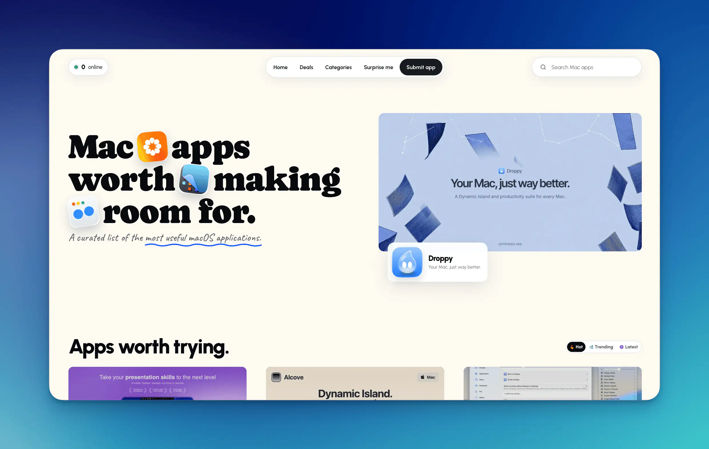

<div align="center">
  
  <h1>Macify</h1>
  <p><strong>Mac apps worth making room for.</strong></p>
  <p>A curated collection of the best macOS software.</p>
  <p>
    <a href="https://macify.app"><kbd>⌘&nbsp; Browse apps</kbd></a>&nbsp;
    <a href="CONTRIBUTING.md"><kbd>🌱&nbsp; Suggest an app</kbd></a>&nbsp;
    <a href="https://github.com/Beingpax/macify/issues/new/choose"><kbd>💬&nbsp; Share feedback</kbd></a>
  </p>
</div>

## 🔎 Find your next favourite Mac app

Macify brings together excellent macOS applications across a wide range of categories. Every app is selected for its quality, usefulness, and ability to make the Mac experience better.



The collection includes both free and paid software. It is focused entirely on applications made for macOS, so iPhone and iPad apps are not included.

Browse the collection, search for a specific tool, or take the surprise route. Every listing explains what the app does, who it suits, what it costs, and what you should know before installing it.

## 💡 Know a good one?

Made a Mac app you are proud of? Know a great app that belongs in the collection but is not here yet? You are welcome to suggest it.

Read the [contribution guidelines](CONTRIBUTING.md) to learn how to add an application or a verified deal. Each public contribution can introduce one new application or deal manifest. If an existing listing needs a correction, or you have an idea for Macify itself, [open an issue](https://github.com/Beingpax/macify/issues/new/choose).

You can also help the project grow:

- ⭐ Star the repository so more Mac users can discover it.
- 🔀 Fork the repository when you are ready to contribute.

Every contribution helps us build a better collection of high quality macOS applications.

## 🛠️ Make it run locally

Macify uses Next.js and TypeScript on Cloudflare Workers.

Use Node.js 22, matching the repository’s CI workflows. To run it locally:

```bash
npm install
npm run cf-typegen
npm run db:migrate:local
npm run dev
```

The development server prepares the local catalogue when it starts. Use `npm run setup` to refresh local data and artwork.

Before submitting changes, run the checks that match your work:

```bash
npm run typecheck
npm run lint
npm run db:check
```
